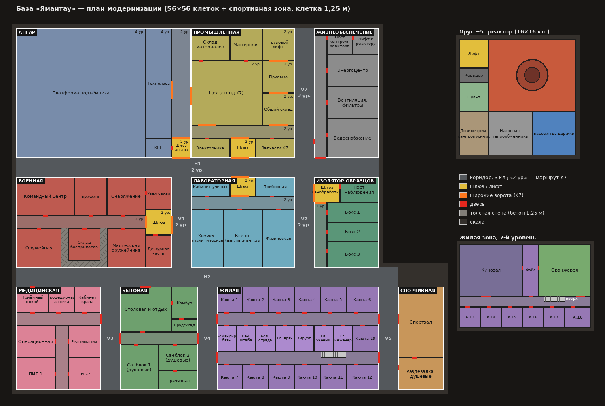

# План модернизации базы «Ямантау»

25.11.2026 · схема и проверка плана — `tools/base/plan_v2.py`

## Задачи модернизации

База перестраивается из вытянутого плана 56×33 клетки в квадрат 56×56 клеток (70×70 м): ангар и восемь зон, разделённых коридорами шириной 3 клетки. У юго-восточного угла к квадрату пристроена спортивная зона 7×16, вся база — 66×56 клеток. Реакторный ярус на −5 этаже — следующим этапом.

- **Зонирование.** Жилая, бытовая, медицинская, лабораторная, изолятор образцов, военная, промышленная, жизнеобеспечения — каждая отдельным прямоугольником.
- **Шлюзы.** В ангар, военную, промышленную, лабораторную зоны и изолятор — только через шлюз с двумя воротами по 3 клетки: проходят K7 (2×2 клетки) и другие роботы. Пока входные ворота шлюза не закрылись, выходные не откроются.
- **Коридоры.** Между зонами — 3 клетки, внутри зон — не меньше 2 клеток (сейчас 1).
- **Каюты.** Двухместные — 4×4 клетки (было 3×3), одноместные для комсостава, врачей и ведущих специалистов — 3×4. Вместо двухъярусных коек — кровати у стен, стол, стулья.
- **Медицина.** Реанимация, операционная, палаты интенсивной терапии — только одноярусные кровати.
- **Лаборатории.** Приборы: микроскопы, спектрометры, вытяжные шкафы, центрифуги, перчаточные боксы.
- **Склад боеприпасов** отделён толстой стеной (бетон 1 клетка, 1,25 м) и взрывозащитной дверью.
- **Высота.** Коридоры, шлюзы и ворота на маршруте K7 — в два уровня (5 м), остальное — в один (2,5 м).
- **Энергия.** Малый ядерный реактор на −5 этаже, к нему — отдельный лифт из зоны жизнеобеспечения (ярус −5 — позже).
- **Спортзал** со своей раздевалкой и душевыми — в пристройке у юго-восточного угла, выход прямо из жилых коридоров.

## Общая схема

База — сетка из трёх рядов зон, разделённых двумя сквозными коридорами H1 и H2 (с запада на восток) и вертикальными V1–V4. Все коридоры между зонами — 3 клетки (3,75 м).

- **Северный ряд (20 клеток):** ангар с проездом к цеху — промышленная зона — V2 — жизнеобеспечение. Тяжёлая техника и всё, что связано с поверхностью: подъёмник ангара, грузовой лифт, лифт к реактору. Северная часть бывшего коридора V1 стала проездом внутри ангара: K7 ходит из ангара в цех, не выходя к остальной базе; в коридор H1 ангар выходит только через шлюз с КПП.
- **Средний ряд (14 клеток):** военная — V1 — лабораторная — V2 — изолятор образцов. Все три зоны за шлюзами. Военная зона прямо под ангаром: от снаряжения до конвертоплана — через шлюз и коридор V1, около 20 м.
- **Южный ряд (16 клеток):** медицинская — V3 — бытовая — V4 — жилая — V5 — спортивная. Люди живут дальше всего от ангара, грузового лифта и изолятора; столовая и санблоки между каютами и медициной, спортзал — сразу за жилыми коридорами.

Размеры: квадрат 56×56 клеток = 70×70 м, с пристройкой 66×56 клеток (82,5×70 м). Поле карты базы расширено с 58×58 до 68×68. Коридоры между зонами занимают 633 клетки (около 990 м²). Схема строится скриптом `tools/base/plan_v2.py` и проверяется им же: ни одно помещение не пересекается с другим, пустых клеток в зонах нет.

Оранжевые черты — широкие ворота (K7), красные — двери, жёлтые помещения — шлюзы и лифты, штриховка — бетонные стены склада боеприпасов.

## Зоны

Координаты — в клетках плана (x с запада на восток, y с севера на юг), клетка 1,25 м.

| Зона | Клетки (x, y) | Размер, кл. | Площадь, м² | Доступ |
| --- | --- | --- | --- | --- |
| Ангар (с проездом к цеху и шлюзом) | 0–26, 0–19 | 27×20 | 844 | шлюз ангара в H1, КПП у шлюза |
| Промышленная | 27–42, 0–19 | 16×20 | 500 | шлюз из H1 |
| Жизнеобеспечение | 46–55, 0–19 | 10×20 | 312 | проход из H1 |
| Военная | 0–23, 23–36 | 24×14 | 525 | шлюз из V1 |
| Лабораторная | 27–42, 23–36 | 16×14 | 350 | шлюз из H1 |
| Изолятор образцов | 46–55, 23–36 | 10×14 | 219 | шлюз санобработки из V2 |
| Медицинская | 0–12, 40–55 | 13×16 | 325 | проход из V3 |
| Бытовая | 16–27, 40–55 | 12×16 | 300 | проходы из H2, V3, V4 |
| Жилая | 31–55, 40–55 | 25×16 | 625 | проходы из V4 и V5 |
| Спортивная | 59–65, 40–55 | 7×16 | 175 | проход из V5 |
| Коридоры H1, H2, V1–V5 | — | ширина 3 | 989 | — |

Внутри зон коридоры по 2 клетки (2,5 м): по ним проходит K7 (площадка 2×2) там, где он нужен: в промышленной, военной, лабораторной зонах и изоляторе.

## Жилая зона

Первый уровень: 20 кают на 33 места — 13 двухместных (каюты 1–12 и 19) и 7 одноместных, три ряда по обе стороны двух коридоров шириной 2 клетки. Коридоры сквозные: с запада выход в V4, с востока — в V5 к спортзалу.

Второй уровень (над жилой зоной, пол на высоте 2,5 м), лестница — в южном коридоре первого уровня (4 ступени-клетки вдоль коридора, подъём на восток), проём наверху огорожен перилами:

| Помещение | Размер, кл. | Над чем | Обстановка |
| --- | --- | --- | --- |
| Кинозал | 12×10 | комсостав, каюты 1–3 | экран у западной стены, 8 рядов кресел, проектор |
| Фойе | 3×10 | хирург, каюта 4 | диван, автомат с напитками, растения; двери в кинозал, оранжерею и коридор |
| Оранжерея | 10×10 | главные специалисты, каюты 4–6 и 19 | стеллажи гидропоники, грядки, деревья в кадках, фонтан со скамьями |
| Коридор | 25×2 | южный коридор | проём лестницы |
| Каюты 13–18 | 4×4, 18-я — 5×4 | каюты 7–12 | как двухместные первого уровня |

Каюта, которая раньше была 13-й (4×4 в среднем ряду), теперь 19-я: номера 13–18 у кают второго уровня.

| Каюта | Размер, кл. | Площадь, м² | К нынешней (3×3, 14 м²) | Сколько |
| --- | --- | --- | --- | --- |
| Двухместная | 4×4 | 25 | ×1,8 | 11 |
| Двухместная угловая | 5×4 | 31 | ×2,2 | 2 |
| Одноместная | 3×4 | 19 | ×1,3 (на человека ×2,7) | 7 |

Ровно ×1,5 на сетке не получается: 13,5 клетки не складываются в прямоугольник, 3×4 даёт ×1,3, 4×4 — ×1,8. Для двухместных выбран 4×4: две кровати у противоположных стен и стол между ними в 3×4 не помещаются с проходом.

**Обстановка (двухъярусных коек больше нет):**

- Двухместная: две кровати у боковых стен, у каждой тумбочка; стол у дальней стены, два стула; два шкафа у двери; полка над столом.
- Одноместная: кровать, тумбочка, письменный стол с креслом, шкаф, у командира базы — ещё сейф и терминал связи.
- Двери кают — обычные одностворчатые; мебель ставится так, чтобы не заслонять дверь, а клетка у входа остаётся свободной.

**Расселение (предложение):**

| Кто | Людей | Каюты |
| --- | --- | --- |
| Комсостав: командир базы, начальник штаба, командир отряда | 3 | 3 одноместные |
| Врачи: главный врач, хирург | 2 | 2 одноместные |
| Главный научный сотрудник, главный инженер | 2 | 2 одноместные |
| Бойцы: отряд 6 + резерв 4 (дежурный офицер по базе, помощник дежурного, КПП, оружейная) | 10 | 5 двухместных |
| Учёные | 7 | каюты 6–9 (одно место свободно) |
| Инженеры | 7 | каюты 10–12 и 19 (одно место свободно) |
| Повара | 2 | каюта 13 |
| Уборка помещений | 2 | каюта 14 |
| Медсестра | 1 | каюта 15 |
| Электрик, сантехник | 2 | каюта 16 |
| Резерв для спасённых | — | каюты 17 и 18 |

Итого 38 человек, мест 45 (из них 4 — резерв для спасённых). В игре 8 учёных и 8 инженеров (склад базы `basestore.js`); главные из них живут в одноместных, обслуживающий персонал — в каютах второго уровня, спасённые в заданиях — в каютах 17 и 18.

## Бытовая и медицинская зоны

Бытовая зона (12×16) стоит между каютами и медициной, медицинская (13×16) — у западного края, ближе всего к ангару по коридорам H2 и V1: раненых с конвертоплана везут не через жилые помещения.

| Помещение | Размер, кл. | М² | Оборудование |
| --- | --- | --- | --- |
| Столовая и отдых | 8×7 | 88 | столы на 16 мест (две смены), раздаточная стойка, диваны, экран |
| Камбуз | 4×5 | 31 | нынешний камбуз из нержавейки, на один ряд столов больше |
| Продсклад | 4×2 | 13 | холодильные шкафы, стеллажи |
| Санблок 1 | 6×7 | 66 | 6 душевых кабин, туалеты, умывальники, раздевалка |
| Санблок 2 | 6×4 | 38 | 4 душевые кабины, туалеты |
| Прачечная | 6×3 | 28 | стиральные и сушильные машины, стол для глажки |
| Приёмный покой | 5×4 | 31 | кушетки, пост медсестры, дефибриллятор |
| Процедурная, аптека | 4×4 | 25 | шкафы с лекарствами, холодильник, процедурное кресло |
| Кабинет врача | 4×4 | 25 | стол, кушетка, рентген / УЗИ на стойке |
| Операционная | 6×5 | 47 | операционный стол, бестеневая лампа, наркозный аппарат, инструментальные столики, мойка хирурга |
| Реанимация | 5×5 | 39 | 2 кровати с мониторами, аппарат ИВЛ, инфузоматы |
| ПИТ-1 | 6×5 | 47 | 3 кровати, мониторы, ширмы |
| ПИТ-2 | 5×5 | 39 | 2 кровати, мониторы |

В медицинской зоне только одноярусные кровати: всего 7 коек и операционный стол. Коридор внутри — буквой Т шириной 2 клетки, проходит каталка.

## Лабораторная зона и изолятор образцов

Три лаборатории по 5–6×9 клеток и изолятор с тремя боксами стоят рядом, но разделены коридором V2: образцы возят из изолятора в лабораторию через два шлюза.

| Помещение | Размер, кл. | М² | Приборы и оборудование |
| --- | --- | --- | --- |
| Шлюз лабораторий | 4×3 | 19 | ворота 3 кл. в H1 и во внутренний коридор, шкафы с халатами |
| Кабинет учёных | 6×3 | 28 | рабочие столы, серверная стойка, доска |
| Приборная | 6×3 | 28 | электронный микроскоп, рентгеновский дифрактометр, склад реактивов |
| Химико-аналитическая | 5×9 | 70 | вытяжные шкафы, хроматограф, масс-спектрометр, лабораторные столы с мойками, аварийный душ |
| Ксенобиологическая | 6×9 | 84 | перчаточные боксы, микроскопы, центрифуги, инкубаторы, криохранилище, секвенатор, стол для вскрытия |
| Физическая | 5×9 | 70 | спектрометры, осциллографы, испытательный стенд для плазменного оружия и брони пришельцев, вакуумная камера |
| Шлюз санобработки | 4×4 | 25 | ворота 3 кл. в V2, душ обеззараживания, стойки с защитными костюмами |
| Пост наблюдения | 6×4 | 38 | пульты, мониторы камер боксов |
| Боксы 1–3 | 8×3, 8×3, 8×4 | 38, 38, 50 | стеклянные камеры с образцами, автоклав, передаточное окно в коридор |

Изолятор стоит в углу базы и граничит только со скалой и коридорами: если образец вырвется, его можно запереть, закрыв один шлюз. Это готовый сценарий для миссии на базе.

## Военная, промышленная зоны и ангар

Платформа подъёмника 20×20 с конвертопланом КТ-6 остаётся, техполоса укорочена до 4×17. К ангару добавлены проезд к цеху 3×17 (бывшая северная часть коридора V1; ворота из техполосы и ворота в цех по 3 клетки), шлюз ангара 3×3 с воротами в проезд и в H1 и КПП 4×3 рядом со шлюзом. Прямых ворот из ангара в H1 больше нет.

**Шлюзы.** У ангара, военной, промышленной, лабораторной зон и изолятора — камера 3×3, 4×3 или 4×4 клетки с двумя воротами. Внешние ворота 3 клетки (3,75 м, две сдвижные створки по 1,8 м), внутренние — 3 клетки или 2 по ширине коридора зоны. K7 (2,5×2,5 м) проходит везде. Пока входные ворота не закрылись, выходные не откроются: кто вошёл в шлюз, ждёт, пока закроются ворота за ним.

| Зона | Помещение | Размер, кл. | М² | Оборудование |
| --- | --- | --- | --- | --- |
| Военная | Командный центр | 9×6 | 84 | тактический стол-карта, пульты операторов, экраны глобуса |
| Военная | Брифинг | 5×6 | 47 | ряды кресел на отряд, экран |
| Военная | Снаряжение | 6×6 | 56 | шкафчики с комплектами, стойки бронежилетов и шлемов |
| Военная | Узел связи | 4×5 | 31 | стойки аппаратуры, радиопульт |
| Военная | Оружейная | 7×6 | 66 | оружейные пирамиды, верстак чистки |
| Военная | Склад боеприпасов | 5×5 | 39 | стеллажи с ящиками; с трёх сторон бетонная стена 1,25 м, вход — взрывозащитная дверь из коридора зоны |
| Военная | Мастерская оружейника | 6×6 | 56 | станки, верстаки, стенд пристрелки |
| Военная | Дежурная часть | 4×5 | 31 | дежурный офицер по базе и помощник, пульт, мониторы камер; у шлюза зоны |
| Ангар | КПП | 4×3 | 19 | пост у шлюза ангара, турникет, мониторы |
| Промышленная | Цех (стенд K7) | 11×10, 2 ур. | 172 | стенд ремонта K7, кран-балка, станки; ворота в проезд ангара и в коридор зоны |
| Промышленная | Склад материалов, мастерская | 6×5, 5×5 | 47, 39 | стеллажи, верстаки |
| Промышленная | Грузовой лифт, приёмка, общий склад | 5×5 каждое | 39 каждое | платформа 4×4 до поверхности, ворота 3 кл. |
| Промышленная | Электроника, запчасти K7 | 6×3 каждое | 28 каждое | паяльные столы; стеллажи с узлами робота |

Двери промышленной зоны: склад материалов и мастерская открываются в цех, электроника и запчасти K7 — во внутренний коридор, грузовой лифт — в приёмку, приёмка — в общий склад, общий склад — в коридор (ворота по 3 клетки). Грузовой лифт за шлюзом промышленной зоны: прорвавшиеся через него пришельцы (нынешний сценарий обороны базы) сначала упираются в шлюз.

## Жизнеобеспечение и энергетика

Энергию даёт компактный реактор на отдельном ярусе −5: пять этажей по 2,5 м ниже пола базы, то есть на 12,5 м глубже (около −43 м, если ярус базы на −30 м). Связь с базой — только отдельный лифт 4×4 клетки и кабельные шахты.

**На уровне базы (зона 10×20 в северо-восточном углу):**

| Помещение | Размер, кл. | М² | Оборудование |
| --- | --- | --- | --- |
| Пост контроля реактора | 4×4 | 25 | дублирующий пульт, дозиметрический контроль; через него — единственный вход к лифту |
| Лифт к реактору | 4×4 | 25 | платформа 3×3 клетки (входит K7), шахта вниз на ярус −5 |
| Энергоцентр | 8×5 | 63 | распределительные щиты, аккумуляторы, резервные дизель-генераторы |
| Вентиляция, фильтры | 8×5 | 63 | вентиляционные установки, фильтры, регенерация воздуха |
| Водоснабжение | 8×6 | 75 | насосы, баки, очистка и подогрев воды |

Коридор зоны открыт в H1 и имеет дверь в V2.

**Ярус −5 (16×16 клеток, врезка на схеме):**

- Реакторный зал 12×10 клеток, высота 3 уровня: корпус реактора в бетонной защите, мостовой кран.
- Насосная с теплообменниками 6×6 рядом с пультом, бассейн выдержки топлива 6×6 в дальнем углу.
- У лифта: коридор, местный пульт 4×4, дозиметрия и санпропускник 4×6.

В игре у карты 4 уровня вверх от пола базы, уровней вниз нет. Поэтому ярус −5 — отдельная небольшая карта (как карты заданий), куда переходят на лифте; в самой базе остаётся платформа лифта и вход в шахту.

## Спортивная зона

Пристройка 7×16 клеток у юго-восточного угла, за коридором V5. Жилые коридоры выходят в V5 напрямую, так что до спортзала — несколько шагов из любой каюты.

| Помещение | Размер, кл. | М² | Оборудование |
| --- | --- | --- | --- |
| Спортзал | 7×11 | 120 | беговые дорожки, велотренажёры, силовые станции, штанги и стойки, маты, груша, турник и брусья |
| Раздевалка, душевые | 7×5 | 55 | шкафчики, скамьи, 4 душевые кабины |

## Этапы реализации

Шаги 1–5 сделаны (ноябрь 2026), ярус −5 — позже.

1. **План.** `tools/base/plan_v2.py` — источник плана карты: кроме схемы пишет `tools/render/base_plan.js` и `game/js/base_plan.js` (модули — зоны, помещения, коридоры, двери, ворота, шлюзы). `plan.py` оставлен как прежний план. Поле карты базы 68×68, план со столбца 1 и строки 6. Быстрая проверка правок — `tools/render/base_quick.sh`.
2. **Разметка** (`outpost_layout.js`, `baseMap`). Регионы: зал ангара (платформа и техполоса), каждое помещение, внутренний коридор каждой зоны, общие коридоры H1, H2, V1–V5; стены по границам регионов. Двери в одну клетку — как раньше. Проёмы шире клетки — группы дверей (`layout.gates`, в игре `MAP.gates`): ворота шлюзов и ангара с жёлто-чёрными подъёмными створками и двойные двери в 2 клетки. Бетонные блоки вокруг склада боеприпасов.
3. **Мебель и оборудование** — `tools/render/furniture.js` (модели) и `tools/render/base_furniture.js` (расстановка по помещениям): кровати, тумбочки, шкафы, столы со стульями, сейф, диваны, обеденные столы, раздача; функциональные кровати с мониторами, операционный стол с лампой, наркозный аппарат; душевые кабины, умывальники, кабинки туалетов, стиральные машины; беговые дорожки, велотренажёры, силовая рама, скамья, гантели, маты, груши; вытяжные шкафы, боксы биобезопасности, приборные стойки, испытательный стенд, колбы с образцами, морозильники; стойки с оружием, стол-карта, экраны, ряды кресел, станки, стенд K7. Камбуз перенесён в новое помещение 4×5.
4. **Игра** (`game.js`). Ворота группы открываются вместе; у шлюза вторые ворота не начинают открываться, пока первые не закрылись. Кто идёт через ворота или двойную дверь, ждёт, пока створка поднимется; ждущий у шлюза закрывает ворота за собой, даже если у них кто-то стоит. В 2D-режиме (тайлы) створка ворот уходит вверх. Меню базы: модули по зонам, каюты и рабочие места персонала по новым помещениям (`basestore.js`, сохранённый склад базы переносится). Высадка: отряд — в техполосе ангара, K7 — в проезде к цеху, пришельцы — у грузового лифта. Проверено: K7 проходит через шлюзы во внутренние коридоры военной, промышленной, лабораторной зон и изолятора, боец доходит до каждого помещения.
5. **Тайлы и 3D-осмотр** перестроены.
6. Позже — ярус −5: отдельная карта 16×16 с реактором и переход на неё через лифт.

**Маршрут K7 в два уровня (5 м).** K7 в игре высотой 4 м, поэтому всё, где он ходит, сделано в два уровня: коридоры H1, V1, V2, проезд к цеху, все шлюзы, внутренние коридоры промышленной, военной, лабораторной зон и изолятора, грузовой лифт, приёмка, общий склад (цех и ангар были выше и раньше). Ворота между такими помещениями — высотой 4,4 м: створка из двух частей, по одной на уровень, поднимается целиком. Остальные коридоры (H2, V3–V5) и помещения — в один уровень; где двухуровневый V1 выходит в H2, над проходом стена второго уровня.

## Персонал на карте

Все, кто живёт на базе, кроме бойцов отряда, стоят на своих рабочих местах (`BaseStore.people`, `game.js`, `baseStaffUnits`): в мирной обстановке — стоя, при нападении — присев, к отряду не присоединяются. Спрайты — `tools/render/civilian.js` (тела и лица — `human.js` на основе базовой сетки MakeHuman, см. `tools/render/mh/README.md`; одежда — слои по сглаженной сетке тела с тканевыми текстурами (саржа, полотно, трикотаж, деним), свободный крой: штанины и рукава прямые, куртка ниже груди не облегает талию, подол отходит от брюк; у формы и рабочих комбинезонов — мешковато, штанины рабочих заправлены в ботинки; воротники (стойка и отложной край) и лацканы — по поверхности тела, у кителя в вырезе рубашка с галстуком, поверх — ремень; костюм биозащиты — глянцевый ПВХ), наборы `civ<вид>` (стоит, ходьба 16 кадров, присел, падение, лежит; 8 направлений) и портреты:

| Вид | Кто |
| --- | --- |
| commander | командир базы, начальник штаба, командир отряда: полевая форма, фуражка, погоны |
| officer | дежурный офицер, помощник, часовой КПП, дежурный по оружейной: форма, погоны, красная повязка |
| doctor | главный врач: белый халат поверх голубого костюма, фонендоскоп |
| surgeon | хирург: зелёный костюм, шапочка, маска, перчатки |
| nurse | медсестра: белый костюм, шапочка, фонендоскоп |
| scientist, labwoman | учёные в белых халатах |
| hazmat | учёные ксенобиологии в костюмах биозащиты: жёлтый комбинезон из ПВХ с капюшоном, панорамное стекло в светлой рамке, чёрная полумаска с двумя фильтрами, чёрные перчатки и сапоги, нашивка на груди |
| engineer, engineerw | инженеры: комбинезон, сигнальный жилет, каска, планшет |
| electrician, plumber | электрик и сантехник: комбинезоны, пояс с инструментом, перчатки |
| cook, cookw | повара: белая куртка, колпак, фартук |
| cleaner, cleanerm | уборка помещений: синий рабочий халат, резиновые перчатки |

## Будущие модули

Пока не ставятся.

- **ПВО** — на ярусе выше, под самой поверхностью: ракетные шахты с отъезжающими крышками, пуски из базы.
- **Радары** — возможно, не на этой базе: отдельные радарные базы и задание по их обороне.
- Склады, мастерские, жилые модули, фотолаборатория — новые зоны в `plan_v2.py` (свободная скала к востоку от изолятора и к югу от базы), обстановка — в `base_furniture.js`.
