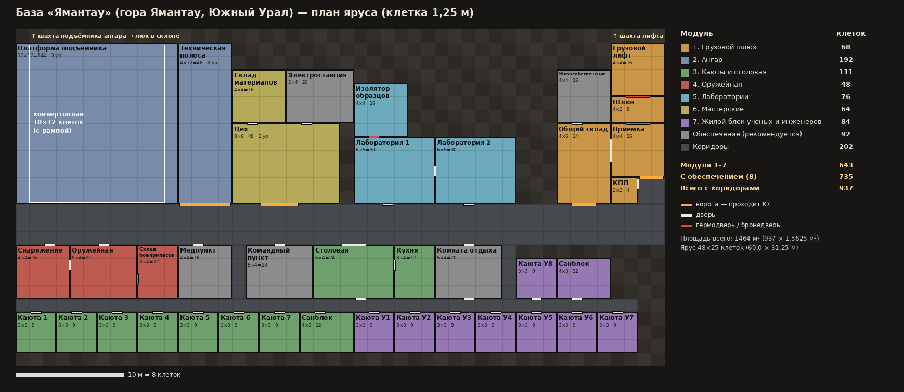
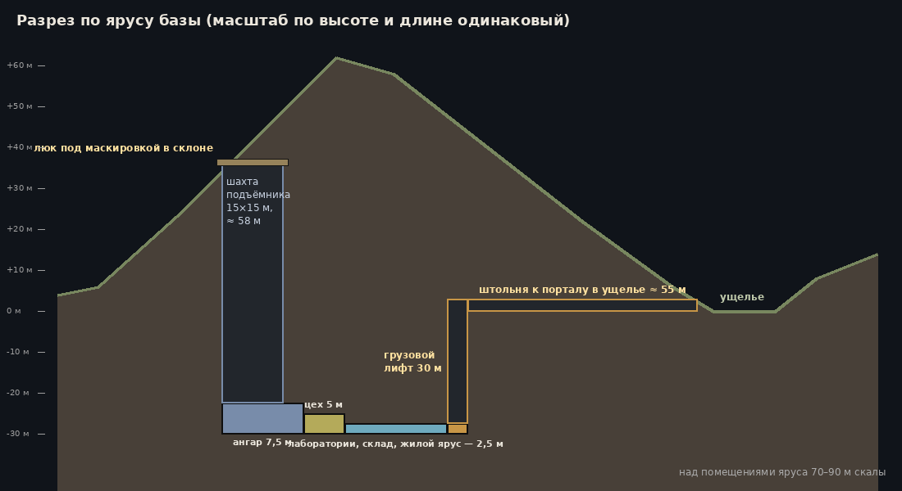
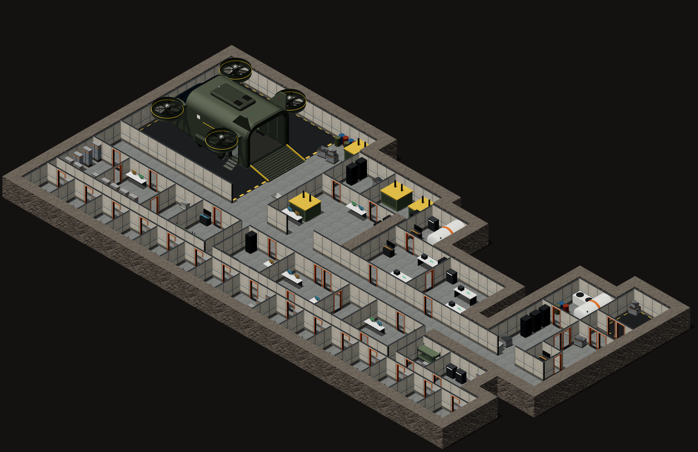
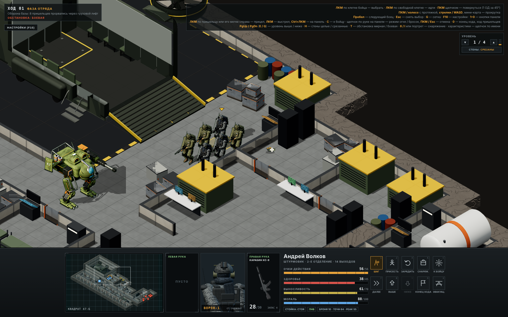
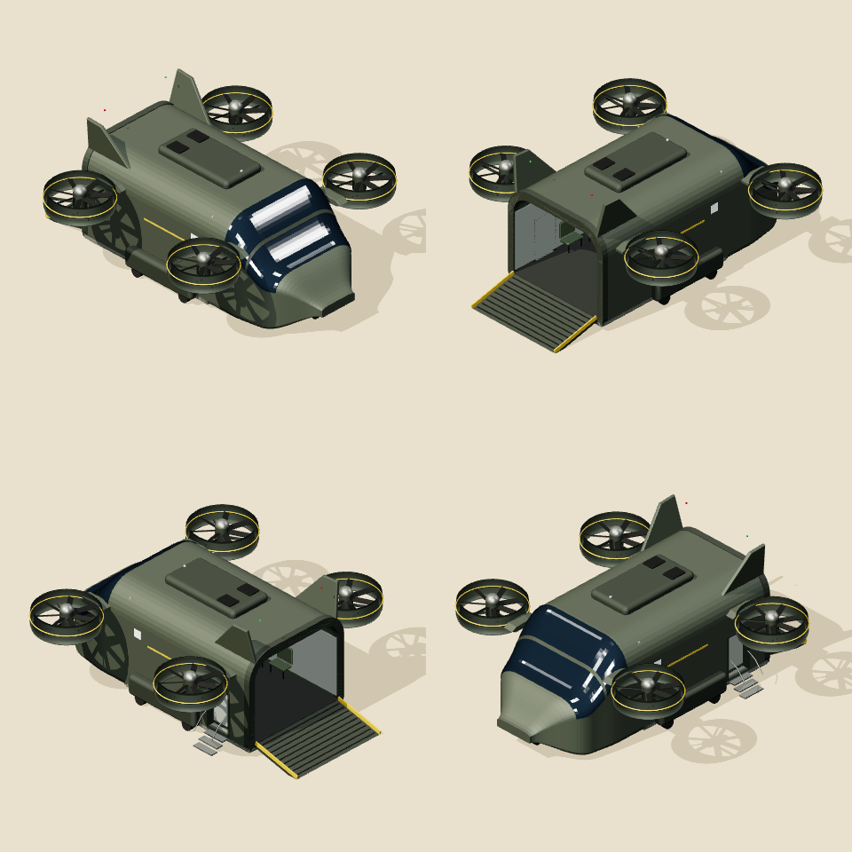
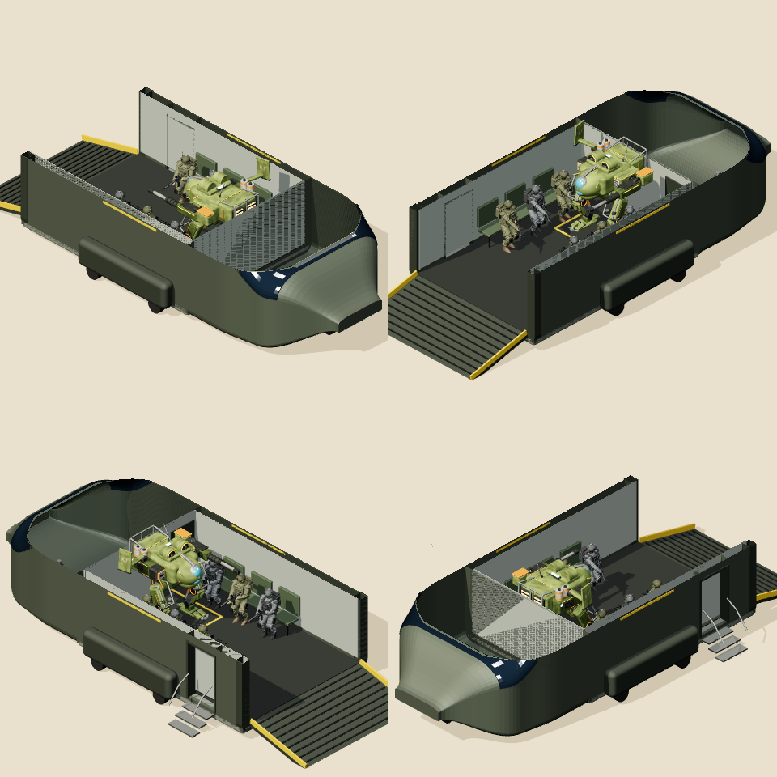

# База «Ямантау» — план и конвертоплан КТ-6

24.11.2026

## Замысел

База «Ямантау» — в одноимённой горе на Южном Урале (54°15′ с. ш., 58°06′ в. д.). Это один подземный ярус площадью 48×25 клеток (60 × 31 м) на глубине 30 м ниже дна ущелья, под 70–90 м скалы. С поверхности видны только два входа, оба замаскированы:

- **люк подъёмника ангара** в склоне горы — над шахтой 15×15 м, по ней конвертоплан поднимается на платформе, как самолёт на лифте авианосца;
- **портал штольни** в ущелье — от него 55 м горизонтальной штольни до грузового лифта, который опускается на 30 м к ярусу.

Всё на одном ярусе, потому что K7 по правилам игры ходит только по нижнему уровню, а ему нужны ангар, цех и главная галерея. Отличие от UFO: не сетка одинаковых модулей 6×6, а залы разного размера, вырубленные в скале по зонам, с цельной скалой между ними.

Исходные числа из игры: клетка 1,25 м, уровень 2,5 м. Модель K7 — 3,1 × 3,3 м в плане и 3,2 м в высоту (в игре его высота принята 4 м), занимает 2×2 клетки. Поэтому главная галерея и ворота, через которые ходит K7, шириной 3 клетки (3,75 м), а залы, куда он заходит, высотой не меньше 2 уровней.

## Модули и число клеток

Семь заказанных модулей занимают **643 клетки**; с необходимым обеспечением и коридорами база — **937 клеток (1464 м²)**. Расчёт на 30 человек: 12 бойцов (два отделения по 6), 2 пилота, 8 учёных, 8 инженеров. Одна клетка = 1,5625 м²; размеры помещений — в клетках, ширина × длина.

| № | Модуль | Помещения | Клеток | м² |
| --- | --- | --- | --- | --- |
| 1 | Грузовой шлюз | лифт 4×4 (платформа 5×5 м), шлюз с двумя гермодверями 4×2, приёмка 4×4, КПП 2×2, общий склад 4×6 | 68 | 106 |
| 2 | Ангар | платформа подъёмника 12×12, техническая полоса 4×12 (заправка, боеприпасы, пульт); высота 3 уровня (7,5 м) | 192 | 300 |
| 3 | Каюты и столовая | 7 двухместных кают 3×3 (14 человек), санблок 4×3, столовая 6×4 на 16 мест (две смены), кухня с продскладом 3×4 | 111 | 173 |
| 4 | Оружейная | снаряжение (сборы перед вылетом) 4×4, оружейная на 14 комплектов 5×4, склад боеприпасов за бронедверью 3×4 | 48 | 75 |
| 5 | Лаборатории | 2 лаборатории 6×5, изолятор образцов 4×4 (вход только через лабораторию) | 76 | 119 |
| 6 | Мастерские | цех 8×6 высотой 2 уровня со стендом ремонта K7, склад материалов 4×4 | 64 | 100 |
| 7 | Жилой блок учёных и инженеров | 8 двухместных кают 3×3 (16 человек), санблок 4×3 | 84 | 131 |
|  | **Итого модули 1–7** |  | **643** | **1005** |
| 8 | Обеспечение (не заказано, но без него база не работает) | электростанция 5×4, жизнеобеспечение 4×4, командный пункт 5×4, медпункт 4×4, комната отдыха 5×4 | 92 | 144 |
|  | Коридоры | главная галерея 48×3, жилой коридор 46×1, два прохода между ними, выход приёмки | 202 | 316 |
|  | **Всего** |  | **937** | **1464** |

## Схема яруса и разрез

Все помещения выходят либо в главную галерею (с запада на восток через весь ярус), либо в жилой коридор вдоль южного края; между ними два прохода. Зоны:

- **запад — боевая:** ангар, цех с ремонтом K7, а напротив ангара через галерею — снаряжение, оружейная, склад боеприпасов и медпункт: отряд собирается в десяти метрах от конвертоплана;
- **центр — научная:** две лаборатории и изолятор образцов за гермодверью; командный пункт, столовая и комната отдыха — через галерею;
- **восток — приёмка грузов:** лифт → шлюз → приёмка → общий склад и галерея, у выхода КПП; жизнеобеспечение рядом с шахтой лифта, через неё идёт воздух;
- **юг — жилая:** 15 кают и два санблока вдоль коридора шириной 1 клетка — узкое место при обороне базы.

K7 проходит только там, где ширина 3 клетки и больше: ангар (ворота 4 клетки), галерея, цех (ворота 3 клетки). На схеме оранжевым — ворота, белым — двери, красным — гермодвери и бронедвери.

## Карта в игре

По плану собрана игровая карта `game/base.html`: все 39 помещений и 5 коридоров, 937 клеток пола. Вокруг помещений — скала со срезом сверху, дальше темнота. Ангар высотой 3 уровня с конвертопланом на платформе подъёмника, его салон и рампа — зона эвакуации.

## Конвертоплан КТ-6 «Гриф»

Тяжёлый транспортный конвертоплан с четырьмя поворотными винтами в кольцевых каналах (диаметр канала 3,1 м). Винты в каналах выбраны вместо открытых: у конвертопланов с двумя открытыми винтами размах вместе с винтами больше 15 м, и они не поместились бы в шахту 15×15 м. На стоянке каналы стоят горизонтально, как при вертикальном взлёте.

| Параметр | Значение |
| --- | --- |
| Длина с опущенной рампой | 15 м (12 клеток) |
| Ширина по каналам | 12,5 м (10 клеток) |
| Высота по килям | 6,5 м |
| Салон | 4×6 клеток (5 × 7,5 м), высота 4 м, пол на 0,6 м над землёй |
| Входы | кормовая рампа во всю ширину салона (2 клетки длиной); боковая дверь с трапом из трёх ступеней по правому борту; дверь в кабину пилотов |
| Места | 6 откидных сидений + место K7 с кольцами для крепления |

Раскладка салона по клеткам: столбцы A–D слева направо, ряды 1–6 от кабины к рампе.

- **K7** заходит по рампе и идёт по средней полосе B–C, стоит в рядах 1–2 (жёлтая разметка). Модель длиннее двух рядов и заходит в третий, но мимо сидений проходит с зазором около 0,5 м.
- **Сиденья** — A2–A4 и D2–D4, по три вдоль бортов.
- **Дверь в кабину** — в передней переборке в A1; **боковая дверь** — D5; A5–A6 и D6 свободны для груза.

Размеры проверены расстановкой игровых моделей K7 и шести бойцов в салоне (разрез ниже, крыша срезана на высоте 3 м). Модель — `tools/render/vehicles.js`, функция `buildTiltrotor`.

## Допущения и открытые вопросы

- Численность (30 человек) выбрана мной для расчёта; другие цифры меняют модули 3, 5, 6, 7 — каюта 3×3 на двоих, лаборатория 6×5 на 4 учёных, цех 8×6 на 8 инженеров.
- Ярус один. Если нужна вторая очередь (больше лабораторий, тюрьма для пленных, ангар на два корабля), её удобно добавить вторым ярусом над жилой зоной — K7 туда не нужен.
- Высоту K7 в игре (4 м) стоит сверить с моделью (3,2 м): от неё зависят линия огня и высота дверей.
- Карта базы собрана по этому плану (`game/base.html`): бой «Оборона базы «Ямантау»» — отряд у рампы конвертоплана, K7 у ворот ангара, 8 пришельцев вошли через грузовой лифт. Открывается кнопкой «БАЗА» на глобусе; на глобусе у базы своя зелёная метка.
- Тайлы для неё сделаны: скала вокруг помещений со срезом сверху, стены, двери, ворота-проёмы, платформы подъёмников, обстановка из имеющихся предметов и конвертоплан, разрезанный по клеткам. Данные плана — `docs/base/base_plan.json`, разметка карты — `tools/render/outpost_layout.js` (MAP=base).
