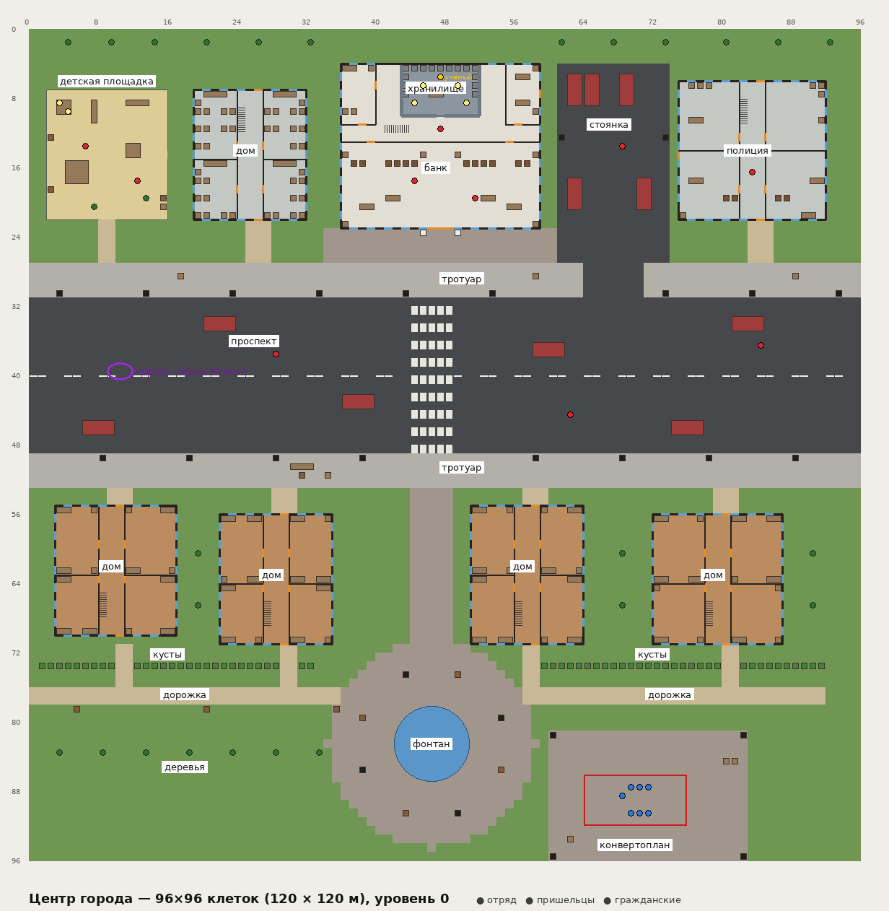
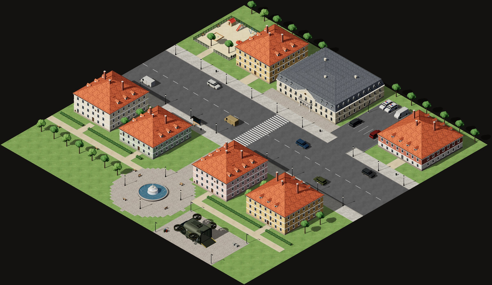

# Центр города — карта задания «Спасение в центре города»

Карта `city`: 96 × 96 клеток (сторона в два раза больше карты `tiles_big.html` 48 × 48), клетка 1,25 м — 120 × 120 м.
4 уровня по 2,5 м. Разметка — `tools/render/city_layout.js`, картинки плана — `docs/city/city_plan_l0.png` (земля),
`city_plan_l1.png`, `city_plan_l2.png` (этажи 1 и 2). Перерисовать план: `node tools/city/dump_layout.mjs layout.json`,
затем `python tools/city/plan_image.py layout.json out.png <уровень>`.

Общий вид карты (собран из тайлов, `tilesetbuild.py`):

Игра: `game/city.html`, на глобусе — метка «СПАСЕНИЕ В ГОРОДЕ» (Санкт-Петербург), выбор щелчком по метке
или кнопкой «ДРУГОЕ ЗАДАНИЕ», затем «НАЧАТЬ ЗАДАНИЕ».

## Задание

Пришельцы проникли в центр города, чтобы похищать людей.

- В хранилище банка укрылись 5 человек. Среди них учёный — профессор Лебединский. Его нужно спасти и доставить на базу
  (вывезти на конвертоплане).
- Двое детей прячутся у домика на детской площадке. Их тоже нужно спасти.
- Уничтожать пришельцев не обязательно: главное — вывезти учёного и детей (эвакуация на конвертоплане). Если пришельцы
  уничтожены, задание не кончается, пока учёный и дети не будут доставлены на конвертоплан (в салон или на рампу).
- Время ограничено: через 30 минут реального времени открывается портал на западном конце проспекта, и через него
  входят крупные силы пришельцев. Одновременно открывается второй портал на стоянке между банком и полицией.
- В полиции дежурят трое полицейских с пистолетами; они стреляют по пришельцам.

Силы: отряд из 6 бойцов и K7 высаживается из конвертоплана на площадке в юго-восточном углу. Пришельцев 12: четверо
в банке (операционный зал, коридор у хранилища, второй этаж), двое на детской площадке, трое на проспекте, двое
в полиции (оба на втором этаже), один на стоянке. В дежурной части полиции на первом этаже — трое полицейских
(`MAP.mission.police`): двое у стоек дежурных (81, 20) и (86, 20), лейтенант у входа (79, 13).

Правила (реализация — `game/js/game.js`, данные задания — `MAP.mission` из `city_layout.js`):

- Пока к гражданскому не подошёл боец, тот прячется (поза «присел», сторона `civilians`): не ходит, его нельзя
  выбрать, пришельцы его не выбирают целью (шальная пуля попасть может).
- Когда боец или K7 встаёт на соседнюю клетку (по стороне или по диагонали, без стены между ними), гражданский
  присоединяется к отряду: им можно управлять как бойцом, оружия нет. Очки действия: взрослый 50, ребёнок 44;
  здоровье 30 и 22, брони нет. После этого пришельцы могут в него стрелять.
- Гражданский, который стоит в салоне или на рампе конвертоплана во время эвакуации, считается спасённым.
  Если пришельцы уничтожены, а учёный или кто-то из детей ещё не на борту, появляется сообщение «Доставьте учёного
  и детей на конвертоплан»; когда они в зоне эвакуации, задание выполнено, даже если тем временем открылся портал
  (подкрепление уничтожать не нужно). Спасёнными тогда считаются все выжившие гражданские.
- Часы задания идут в реальном времени, пока вкладка открыта. На плашке хода — «ПОРТАЛ ЧЕРЕЗ мм:сс» и сколько
  гражданских с отрядом. За 5 минут до срока на проспекте появляется круг портала; каждую минуту он разгорается
  ярче, а внутри крепнет энергетический вихрь (5 ступеней, сообщение на каждой минуте; на последних минутах над
  вихрем встаёт столб света). Через 30 минут портал вспыхивает (звук `portal` в `sound.js`, сообщение «Обнаружено
  появление пришельцев» — без числа пришельцев и порталов; с 3-й по 9-ю секунду звука — треск разрядов, и в такт
  каждому щелчку в портал бьют молнии из столба света: одно расписание `Sound.portalCrackles()` для звука
  и `drawPortalLightning` в `game.js`), и рядом появляются 10 пришельцев (ходят
  со следующего хода пришельцев). Одновременно открывается второй портал на стоянке (67, 11) — 5 пришельцев,
  из них третий по порядку серебристый страж (`MAP.mission.sidePortals`: `at`, `wave`, `elites`, `name`; круг
  и вихрь — как у главного, купол-щит ставит только страж главного портала; в сообщениях боковые порталы
  не упоминаются — игрок узнаёт о втором портале, только если увидит его). Задание продолжается: можно
  эвакуироваться или уничтожить всех, включая подкрепление.
- Полицейские (`policeProfile` в `game.js`) — на стороне отряда, но действуют сами (`policeDecide`), воюют
  из укрытий. В фазе «Полиция», если отряд видит пришельцев: раз за ход занимают позицию в пределах ОД, откуда
  с колена видна цель, — с лучшим укрытием со стороны врага и меньшим числом видящих их пришельцев; приседают
  (стойки, столы, низкие стены закрывают сидящего, по нему труднее попасть); стреляют (не больше двух выстрелов);
  если сидящего видят, а укрытия нет, — отходят из обзора и снова приседают. Раненые и без патронов сразу отходят
  и приседают. В ход пришельцев — ответный огонь. Щелчком игрок берёт полицейского под управление.
  Очки действия 54, здоровье 34, броня 10, меткость 46. Пистолет ПЯ (`Combat.WEAPONS.pistol`): урон 24, дальность
  35, магазин 17, режимы «Прицельный» (14 ОД, точность 0,95) и «Навскидку» (8 ОД, 0,6); при себе 2 запасных
  магазина. Гибель полицейских не влияет на итоги задания и не считается гибелью отряда; они видят и открывают
  туман войны, как бойцы.
- Охрана банка (пост `bank`, `avoidMech`) с K7 в перестрелку не вступает: не стреляет по нему ни в свой ход,
  ни ответным огнём, в том числе через окна. Когда K7 ранит или убивает кого-то из охраны банка, охрана уходит
  из обзора робота вглубь (радиус поста 6 клеток + 4) и укрывается; по бойцам стреляет только оттуда, где робот
  её не видит.
- Двое из волны портала — серебристые стражи (элита): плазменная винтовка (урон 60 против 40 у пистолета), личный щит
  спереди (автомат снимает 10 %, пушка K7 — 25 %; полная перезарядка за 2 хода без попаданий), одноразовый купол-щит
  вокруг портала на 2 хода (радиус 4,6 м; автомат −5 %, K7 −15 %; изнутри стреляют наружу, гранаты пропускает).
  Здоровье серебристого — вдвое больше, чем у зелёного стража. Золотистые стражи — те же, но здоровье ещё вдвое больше;
  они для следующих заданий (`MAP.mission.portalElite`: `silver` или `gold`).
- Граната, упавшая в 1 клетке от пришельца или ближе (без стены между ними), зелёного убивает наверняка, у серебристого
  снимает половину здоровья, у золотистого — четверть (столько же единиц).
- Бросок сверху вниз летит дальше: дальность по горизонтали — 6 м + сила / 3 и ещё 1,5 м за каждый метр, на который
  точка падения ниже бросающего. С крыши школы и с крыши дома напротив граната долетает до портала.

Итоги задания (`results.js`): учёный спасён — да/нет, спасено детей из 2, спасено гражданских из 7 (по именам),
погибло гражданских, убито пришельцев (с подкреплением портала, если он открылся), артефакты, погибшие бойцы,
не эвакуированные, потерянные роботы. Оценка (потерянные бойцы — погибшие и не эвакуированные):
ОТЛИЧНО — спасены все гражданские (7 из 7) и потеряно меньше 3 бойцов; ХОРОШО — спасены учёный и оба ребёнка
и потеряно меньше половины бойцов (из 6 — не больше 2); УДОВЛЕТВОРИТЕЛЬНО — учёный и дети спасены, но потеряна
половина бойцов или больше; иначе (учёный или кто-то из детей не вывезен) ПЛОХО. Сколько пришельцев убито, на оценку не влияет.

## Зоны

Север карты — ряды с меньшими номерами (на экране — верхний правый край). Координаты — (столбец, ряд).

| Зона | Клетки | Что там |
|---|---|---|
| Деревья вдоль северного края | ряд 1 | липы и каштаны |
| Детская площадка | 2..15 × 7..21 | кованая ограда, калитки на юг и на восток; песок, домик, горка, качели, песочница, карусель, скамейки, два дерева |
| Школа | 19..31 × 7..21 | 3 этажа, светлый кирпич; плоская крыша с выходом по лестнице, по краю крыши — сетка 1,9 м |
| Банк | 36..58 × 4..22 | 2 каменных этажа и мансарда; перед входом — мощёная площадка 34..60 × 23..26 |
| Стоянка | 61..73 × 4..26 | асфальт, разметка мест, две полицейские машины, фургон, легковые; въезд через тротуар 64..70 |
| Полиция | 75..91 × 6..21 | 2 этажа, кирпичный фасад с белыми наличниками |
| Тротуар северный | ряды 27..30 | фонари у бордюра через 10 клеток, урны |
| Проспект | ряды 31..48 | 18 клеток, по две полосы в каждую сторону, прерывистая осевая, пешеходный переход 44..48; брошенные машины; место портала (10, 39) |
| Тротуар южный | ряды 49..52 | фонари, остановка с навесом и скамейкой |
| Жилые дома юга | 3..16 × 55..69, 22..34 × 56..70, 51..63 × 55..70, 72..86 × 56..70 | 3, 2, 3 и 3 этажа; фасады кремовый, зелёный, розовый, охристый; парадные на север, чёрный ход на юг. Кремовый дом (напротив детской площадки) — с плоской крышей, выходом на неё и парапетом |
| Аллея к фонтану | 44..48 × 53..71 | мощение от перехода до площади |
| Кусты | ряд 73 | живая изгородь (подстриженная туя высотой 1,5 м, сечение со скруглёнными плечами, текстура мелких веточек) с проходами у задних дверей домов. Стоя через неё видно, присевшего за ней не видно; пули ниже 1,5 м задерживает |
| Дорожки | ряды 76..77 | гравий |
| Деревья | ряд 83 | 7 деревьев |
| Площадь с фонтаном | круг радиусом 12 клеток вокруг (46,5; 82,5) | мощение, фонтан диаметром 9 клеток (чаша со скульптурой непроходима), скамейки и фонари по кругу. Вода фонтана в тайлах — только поверхность; струи (центральная, сливы с двух чаш, восемь косых от бортика) и рябь игра рисует каждый кадр (`drawFountains`/`fountainItems` в `game.js`, центр — `MAP.fountains`) |
| Площадка конвертоплана | 60..82 × 81..95 | мощение, конвертоплан КТ-6: салон (68..73, 87..90), рампа (74..75), зона эвакуации — салон и рампа |

## Здания

Все здания — классические, по образцам: фасад с карнизом и межэтажными тягами, окна с наличниками и сандриками,
крыша не проходима. Исключения — школа и кремовый дом напротив детской площадки (ниже).

- **Жилые дома.** Оштукатуренные фасады пастельных тонов; первый этаж рустован (горизонтальные швы), над окнами
  верхних этажей — сандрики, под крышей — карниз. Крыша вальмовая, красная черепица, слуховые окна, трубы.
  Внутри: коридор по середине (3 клетки) от парадной до чёрного хода, лестница «ножницами» в двух колонках коридора
  (марш с этажа 0 — в одной колонке, с этажа 1 — в соседней, обратно), проёмы над маршами огорожены кованными перилами.
  По сторонам коридора — по две комнаты на этаж, у каждой дверь в коридор. Обстановка: кровать, шкаф, стол, диван,
  книжный шкаф. Пол — паркет.
- **Банк** (образцы — Банк Франции и дворец Кинских). Песчаник, весь фасад рустован; окна первого этажа
  с решётками, второго — с треугольными сандриками; карниз; мансарда из серого шифера со слуховыми окнами,
  над центром фасада — фронтон. Парадный вход — три двери под балконом, по сторонам — две колонны. Служебный
  вход — с востока, к стоянке.
  - Этаж 0: операционный зал (ряды 13..22) со стойками кассиров, диванами и кадками с растениями; стена с двумя
    дверями отделяет коридор (ряды 10..12). Из коридора — тяжёлая дверь хранилища (47, 10); хранилище 43..51 × 4..9
    со стальным полом, по стенам — ячейки, посередине стол. По сторонам хранилища — тамбуры, в крыльях —
    охрана (запад) и бухгалтерия (восток). Лестница на этаж 1 — в коридоре (41..43, 11).
  - Этаж 1: центральный коридор с проёмом лестницы, над хранилищем — архив, над залом — зал совещаний, в крыльях —
    кабинеты (кабинет управляющего — северо-запад). Пол — мрамор.
- **Школа** (у детской площадки). Фасад из светлого силикатного кирпича, первый этаж — руст, белые наличники.
  План — как у жилого дома, в комнатах — классы: доска на северной стене, парты на двоих рядами лицом к доске,
  проход посередине, книжный шкаф. Пол — плитка. Крыша плоская (рулонная кровля), лестница «ножницами» продолжается
  до крыши, проём на крыше огорожен перилами. По краю крыши — сварная сетка 1,9 м на трубчатых стойках
  (стена `mesh`, код 8): пройти нельзя, взгляд, пули и осколки проходят, задерживают только стойки и трубы
  внизу и вверху; гранаты летят над ней.
- **Кремовый дом** напротив детской площадки — тоже с плоской крышей и выходом по лестнице; по краю — парапет 0,56 м
  в цвет фасада (стена `parapet`): за ним можно укрыться присев.
- **Полиция.** Кирпичный фасад, белые наличники и тяги, черепичная крыша. План — как у жилого дома (коридор
  и лестница посередине), обстановка: стойка дежурного, шкафчики, оружейная (стеллажи), комната отдыха, кабинеты.
  Дополнительный вход — со стоянки. Пол — плитка.

## Отличия от эскиза

- Детская площадка поставлена внутри квартала к западу от дома (на эскизе подпись выходит за край), с оградой
  и калиткой к тротуару.
- Проспект — 18 клеток (22 м), на эскизе он примерно такой же относительно домов; добавлен пешеходный переход
  к аллее фонтана, иначе путь от конвертоплана к банку идёт по открытой проезжей части без укрытий.
- Перед банком — мощёная площадка с колоннами у входа; стоянка соединена с проспектом въездом.
- Конвертоплан стоит на мощёной площадке у юго-восточного угла, как на эскизе; от площадки к фонтану и аллее
  ведёт мощение.
- Портал — на западном конце проспекта, далеко от площадки конвертоплана: отряд успевает эвакуироваться,
  если портал открылся.

## Графика

- Фасады (`tools/render/city_scene.js`, `buildCityWall`): стиль стены — `<фасад>_<роль>`, фасады ochre, cream, green, pink,
  bank, police; роль g — первый этаж (руст, цоколь), u — средний, t — верхний (большой карниз с сухариками).
  Окна с переплётом, наличником и подоконником; сандрики треугольные (банк, розовый и кремовый дома) или прямые,
  у первого этажа — замковый камень; у банка внизу арочные окна с архивольтом и решёткой, наверху — треугольные
  сандрики и кованые балкончики. Межэтажная тяга закрывает торец перекрытия. Двери — деревянные двустворчатые
  с филёнками (наружные — зелёные со стеклом), внутренние — деревянные, у хранилища — стальная со штурвалом.
- Перила лестничных проёмов — кованые с деревянным поручнем, ограда площадки — зелёная решётка с пиками.
- Полы: паркет ёлочкой (дома), шахматный мрамор (банк), плитка (полиция), рифлёная сталь (хранилище).
- Земля: асфальт с трещинами, тротуарная плитка, газон с травой, гравийная дорожка, гранитная брусчатка, песок;
  бордюр у проезжей части, поребрик у газона; разметка — осевая и пешеходный переход.
- Крыши — предметы на уровне над верхним этажом (не проходимы): вальмовая черепичная со свесом, водостоками,
  слуховыми окнами и трубами; у банка — мансарда из шифера со слуховыми окнами, фронтон с медальоном и вазами.
  Слуховые окна и трубы стоят по центрам клеток, текстура черепицы повторяется через 2 клетки: одинаковые куски
  скатов рендерятся один раз (`roofCellKey`), куски с трубами, фронтоном и на рёбрах — по месту. Тени крыш
  не рендерятся — тень здания дают стены.
- Предметы: деревья (липа, каштан), кусты, скамейки, урны, фонари, остановка, колонны и балкон банка, фонтан
  с двумя чашами и струями, домик, горка, качели, песочница, карусель; мебель — кровать, шкаф, стол со стульями,
  диван, книжный шкаф, стойки кассиров, ячейки хранилища, кадки с растениями; полицейские машины (полоса, маячки).
- Тайлов 3406, атлас — 3 страницы 2048 × 8192 и 2 страницы теней (`tiles.png`, `tiles1.png`…; в записи тайла —
  номер страницы). Один атлас был бы высотой 24 тыс. пикселей.

## Проверка проходимости

Поиск в ширину от точки высадки (стены, двери, предметы, лестницы): достижимы все 12 пришельцев, все 7 гражданских
и все клетки помещений на всех этажах.
